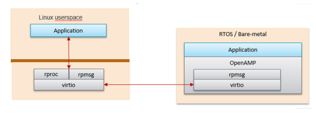

#####################
OpenAMP on Kria SOM
#####################

.. include:: ../../shared/somtoctree.txt

`OpenAMP <https://xilinx-wiki.atlassian.net/wiki/spaces/A/pages/18841718/OpenAMP>`_ support is available for the AMD Kria™ SOM prebuilt images starting from 2022.1 releases. OpenAMP is an open-source standard infrastructure for applications to make use of heterogeneous coprocessors and in Kria, allows the APU to offload tasks to the MPSoC dual-core RPUs.

The Kria Starter Kit OpenAMP PetaLinux implementation uses the Linux kernel implementation of RPMsg for leveraging the MPSoC RPUs as coprocessors. The out-of-box Kria Linux OpenAMP only implements a Linux based master on the APU with the RPU as a client processor with corresponding prebuilt RPU examples.

********************************************************
RPMsg Implementation
********************************************************

The OpenAMP community supports `two models for RPMsg <https://docs.xilinx.com/r/en-US/ug1186-zynq-openamp-gsg/Components-in-OpenAMP>`_ in a Linux master environment:

1. Linux kernel and RPU remote CPU
   
   * RPMsg uses kernel integrated rpmsg and virtio implementations. The Kria implementation does not make use of the Libmetal or OpenAMP libraries in the Linux domain.
   * The Linux kernel space provides rpmsg and remoteproc, but the RPU application requires Linux to load it to talk to the RPMsg counterpart in the Linux kernel.

2. Linux userspace OpenAMP application and RPU remote CPU

   * Linux rpmsg is implemented using the libmetal library with a userspace implementation of virtio
   * OpenAMP library can also be used in a Linux userspace. In this configuration, the remote processor can run independently to the Linux host processor.

The Kria Starter Kit Linux OpenAMP solution uses a Linux kernel implementation (item #1). Details are shown in the following block diagram from the *Libmetal and OpenAMP User Guide* (`UG1186 <https://docs.amd.com/go/en-US/ug1186-zynq-openamp-gsg>`_).

********************************************************
OpenAMP Demos
********************************************************

2026.2 and newer
----------------------

In 2026.2 and newer, the Kria OpenAMP demo runs a `Zephyr application <https://docs.amd.com/r/en-US/ug1186-zynq-openamp-gsg/Running-the-Demo>`_ on the RPU and communicates with Linux on the APU over RPMsg. The Echo Test, Matrix Multiplication and Proxy demos described in `2026.1 and older`_ are deprecated and are not validated in 2026.2.

To run the Zephyr demo, the following are required:

* The prebuilt platform wic image (``edf-platform-disk-image-kria`` for the ``amd-cortexa53-mali-common`` machine), used as is. The image already includes the Zephyr RPU firmware and the ``zephyr_rpmsg_test`` application.
* Linux boot. Boot the default Linux boot entry, not the Xen entry.
* The corresponding 2026.2 Kria boot firmware. With older boot firmware, the RPU firmware starts but ``/dev/ttyRPMSG0`` is never created and ``zephyr_rpmsg_test`` fails.

After booting Linux, run the following on the target. The commands below use the KV260 Starter Kit firmware. The `echo start` and `echo stop` commands are required for each execution of the example application::

   sudo -s                                                                                # This is required so that the ELF loading can occur.
   dmesg | grep remoteproc                                                                # Confirm the RPU remoteproc node is available.
   export BASE_ADDR=ffe00000                                                              # Base address of the RPU core 0 remoteproc node.
   export FW_NAME=xilinx/kv260/rpu/0/kv260-r5-0-rpmsg_multi_services.elf                  # Zephyr firmware, relative to /lib/firmware.
   NODE=$(grep -l "$BASE_ADDR" /sys/class/remoteproc/*/name | sed "s|/name||")            # Find the remoteproc node for that address.
   echo "Found node: $NODE"
   echo $FW_NAME > $NODE/firmware                                                         # Specify the Zephyr firmware to be loaded.
   echo start > $NODE/state                                                               # Load and start the firmware on the RPU.
   zephyr_rpmsg_test                                                                      # Run the Zephyr RPMsg test application.
   echo stop > $NODE/state                                                                # Stop the firmware.

Output of the Zephyr RPMsg test should look like this::

   amd-edf:/home/amd-edf# dmesg | grep remoteproc
   [    0.871843] remoteproc remoteproc0: ffe00000.r5f is available
   amd-edf:/home/amd-edf# export BASE_ADDR=ffe00000
   amd-edf:/home/amd-edf# export FW_NAME=xilinx/kv260/rpu/0/kv260-r5-0-rpmsg_multi_services.elf
   amd-edf:/home/amd-edf# NODE=$(grep -l "$BASE_ADDR" /sys/class/remoteproc/*/name | sed "s|/name||")
   amd-edf:/home/amd-edf# echo "Found node: $NODE"
   Found node: /sys/class/remoteproc/remoteproc0
   amd-edf:/home/amd-edf# echo $FW_NAME > $NODE/firmware
   amd-edf:/home/amd-edf# echo start > $NODE/state
   amd-edf:/home/amd-edf# zephyr_rpmsg_test
   =========================================
   Zephyr OpenAMP RPMsg Test
   =========================================
   Configuration:
     Device:   /dev/ttyRPMSG0
     String:   Hello Zephyr
     Timeout:  10s
   =========================================

   Waiting for /dev/ttyRPMSG0...
   Device /dev/ttyRPMSG0 found

   Running RPMsg communication tests...

   Sending: "Hello Zephyr"
   Sending: "Goodbye Zephyr"

   Received: "TTY 0: Hello Zephyr"
   Received: "TTY 0: Goodbye Zephyr"

   =========================================
   Result: PASSED
   =========================================
   amd-edf:/home/amd-edf# echo stop > $NODE/state

2026.1 and older
----------------------

OpenAMP Device Tree
^^^^^^^^^^^^^^^^^^^^^^

The Kria Starter Kit Linux includes the following device tree placeholders for OpenAMP coprocessing applications:

* remoteproc node
* rpmsg shared memory

Note that PetaLinux based BSP and prebuilt images folder include the necessary device tree nodes and memory reservations. These can be found in the `openamp.dtb` of the 2022.1 release BSP `prebuilt` folder. To run the OpenAMP example, program the SD card with the prebuilt .wic image, and replace `system.dtb` in the SD card's boot folder with `openamp.dtb` (which should be renamed to `system.dtb`), and boot as usual.

AMD-EDF based wic images can be used as is without modification.

Running the Demos
^^^^^^^^^^^^^^^^^^^^^^

From 2022.1 onward, the Kria Starter Kit Linux BSP contains support for the existing OpenAMP community demos, summarized as follows:

* openamp-echo-test: Linux to RPU baremetal communication echo test using rpsmsg.
* openamp-matrix-mul: Linux produces two matrices and sends them to the RPU for multiplication.
* openamp-rpc-demo: Shows the proxy behavior of the RPU as a coprocessor to the APU.

Details about each example applications can be found in the *Libmetal and OpenAMP User Guide* (`UG1186 <https://docs.amd.com/go/en-US/ug1186-zynq-openamp-gsg/OpenAMP-Demos>`_).

In 2022.1 and 2022.2, the PetaLinux BSPs with OpenAMP support require `system.dtb` to be replaced with `openamp.dtb` on the SD boot partition. The required .wic image and `openamp.dtb` are included in `BSPs <https://xilinx-wiki.atlassian.net/wiki/spaces/A/pages/1641152513#PetaLinux-Board-Support-Packages>`_.

In 2023.1 and newer, both Yocto built PetaLinux and BSP based PetaLinux has OpenAMP packages available for installation on target. To download support, do the following on target::

   sudo dnf install open-amp-device-tree
   sudo dnf install packagegroup-petalinux-openamp-echo-test
   sudo dnf install packagegroup-petalinux-openamp-matrix-mul
   sudo dnf install packagegroup-petalinux-openamp-rpc-demo
   sudo reboot

A reboot is required to pick up the OpenAMP device tree.

To run the OpenAMP applications, reference the following commands. The `echo start` and `echo stop` commands are required for each execution of the example application.

Echo Test application::

   sudo -s                                                             # This is required so that the ELF loading can occur.
   echo image_echo_test  > /sys/class/remoteproc/remoteproc0/firmware  # Specify Echo Test Firmware to be loaded.
   echo start > /sys/class/remoteproc/remoteproc0/state                # Load and start target Firmware onto remote processor.
   echo_test                                                           # Run echo test linux application.
   echo stop > /sys/class/remoteproc/remoteproc0/state                 # Stop target firmware.

Output of Echo Test should look like this::

   **************************************

   Echo Test Round 0

   **************************************

   sending payload number 0 of size 17
   echo test: sent : 17
   received payload number 0 of size 17

   sending payload number 1 of size 18
   echo test: sent : 18
   received payload number 1 of size 18
   .
   .
   .
   sending payload number 470 of size 487
   echo test: sent : 487
   received payload number 470 of size 487

   sending payload number 471 of size 488
   echo test: sent : 488
   received payload number 471 of size 488

   ******************
   18 L6 rpmsg_endpoint_cb():36 shutdown message is received.
   19 L7 app():82 done
   20 L6 main():129 Stopping application...
   21 L7 unregistered generic bus
   ********************

   Echo Test Round 0 Test Results: Error count = 0

   **************************************
   xilinx-kv260-starterkit-20221:/home/petalinux#

Matrix Multiplication::

   sudo -s                                                                  # This is required so that the ELF loading can occur.
   echo image_matrix_multiply > /sys/class/remoteproc/remoteproc0/firmware  # Specify Matrix multiplication to get Firmware onto remote processor.
   echo start > /sys/class/remoteproc/remoteproc0/state                     # Load and start target Firmware onto remote processor.
   mat_mul_demo                                                             # Run Matrix multiplication test linux application.
   echo stop > /sys/class/remoteproc/remoteproc0/state                      # Stop target firmware.

Output of Matrix Multiplication should look like this::

   Master : Linux : Input matrix 0
   
   8  7  8  6  7  9
   7  5  1  5  2  8
   7  5  9  9  9  0
   9  0  6  5  2  2
   1  2  1  2  8  7
   8  7  6  6  5  3
   
   Master : Linux : Input matrix 1
   
   7  2  0  0  0  4
   8  7  1  9  8  0
   1  7  3  7  4  5
   0  6  7  1  8  6
   0  8  5  8  6  0
   3  5  4  3  6  4
   0: write rpmsg: 296 bytes
   read results

   Master : Linux : Printing results
   147  258  144  208  232  144
   114  142  85  97  144  95
   98  238  140  189  202  127
   75  116  71  69  88  104
   45  134  87  112  126  49
   127  198  104  160  176  110
   End of Matrix multiplication demo Round 0
   
   Quitting application ..
   Matrix multiply application end

Proxy Application::

   sudo -s                                                             # This is required so that the ELF loading can occur.
   echo image_rpc_demo > /sys/class/remoteproc/remoteproc0/firmware    # Specify proxy application to get Firmware onto remote processor.
   echo start > /sys/class/remoteproc/remoteproc0/state                # Load and start target Firmware onto remote processor.
   proxy_app                                                           # Run proxy application.
   echo stop > /sys/class/remoteproc/remoteproc0/state                 # Stop target firmware

Expected output of Proxy Application::

   Master>RPC service started !!
   Remote>Baremetal Remote Procedure Call (RPC) Demonstration
   Remote>***************************************************
   Remote>Rpmsg based retargetting to proxy initialized..
   Remote>FileIO demo ..
   Remote>Creating a file on master and writing to it..
   Remote>Opened file 'remote.file' with fd = 6
   Remote>Wrote to fd = 6, size = 45, content = This is a test string being written to file..
   Remote>Closed fd = 6
   Remote>Reading a file on master and displaying its contents..
   Remote>Opened file 'remote.file' with fd = 6
   handle_read: 4, 225
   Remote>Read from fd = 6, size = 225, printing contents below .. This is a test string being written to file..This is a test string being written to file..This is a test string being written to file..This is a test string being written to file..This is a test string being written to file..
   Remote>Closed fd = 6
   Remote>Remote firmware using scanf and printf ..
   Remote>Scanning user input from master..
   Remote>Enter name
   Jane
   handle_read: 4, 4
   Remote>Enter age
   29
   handle_read: 4, 3
   Remote>Enter value for pi
   3.14
   handle_read: 4, 5
   Remote>User name = 'Jane'
   Remote>User age = '29'
   Remote>User entered value of pi = '3.140000'
   Remote>Repeat demo ? (enter yes or no)
   no
   handle_read: 4, 3
   Remote>RPC retargetting quitting ...
   Remote> Firmware's rpmsg-rpc-channel going down!

Resources
----------------------

* `OpenAMP Wiki <https://xilinx-wiki.atlassian.net/wiki/spaces/A/pages/18841718/OpenAMP>`_
* `*Libmetal and OpenAMP User Guide* (UG1186) <https://docs.amd.com/go/en-US/ug1186-zynq-openamp-gsg>`_

.. Copyright © 2023–2026 Advanced Micro Devices, Inc

.. `Terms and Conditions <https://www.amd.com/en/legal/copyright.html>`_.
